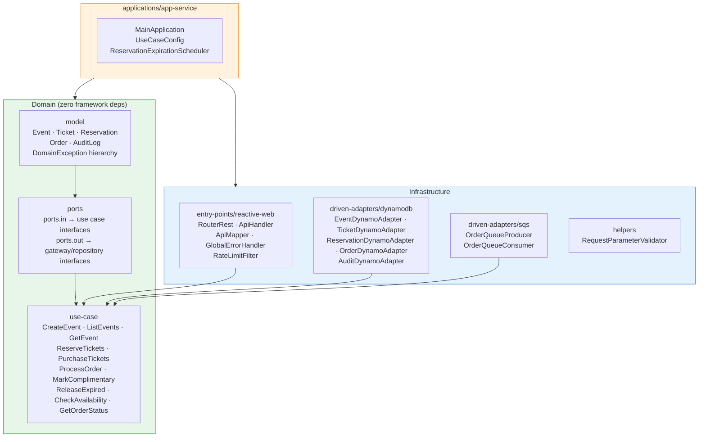
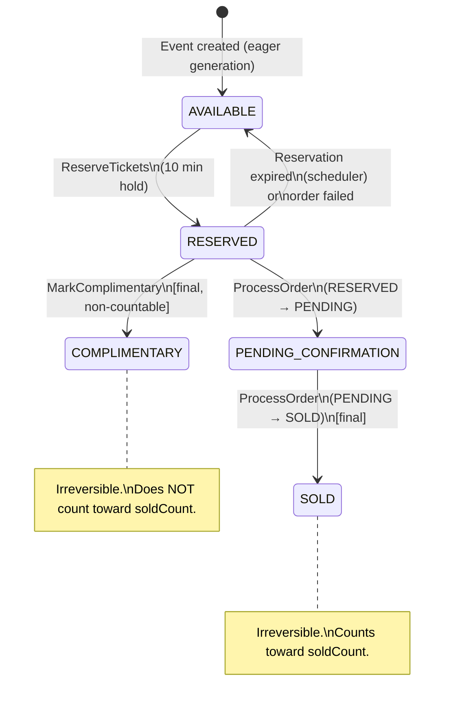
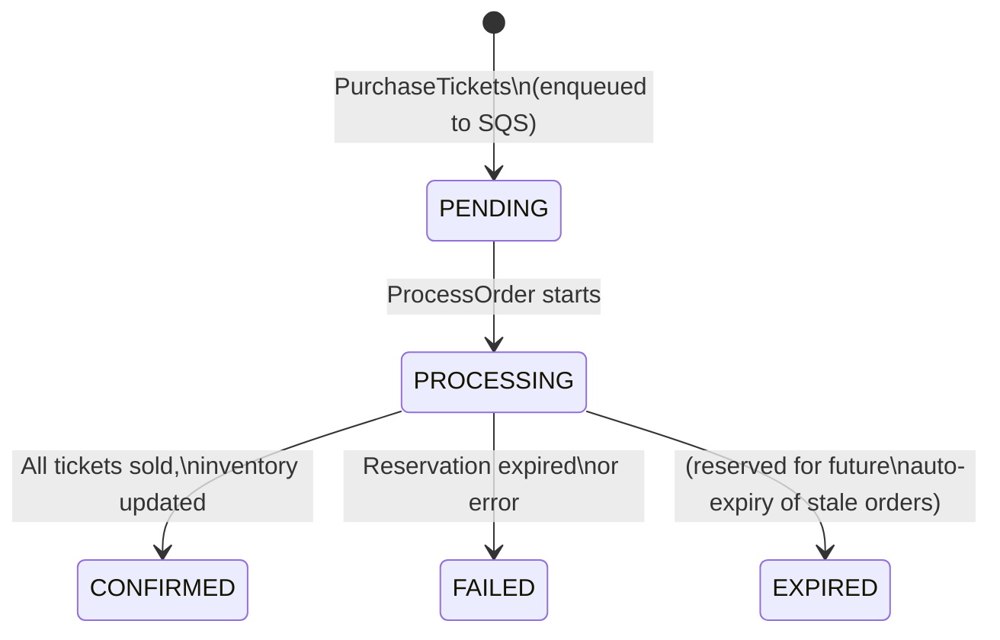
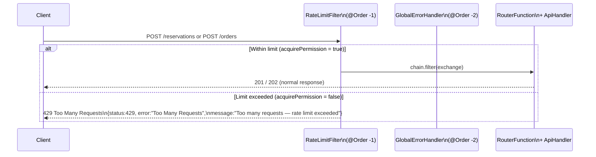
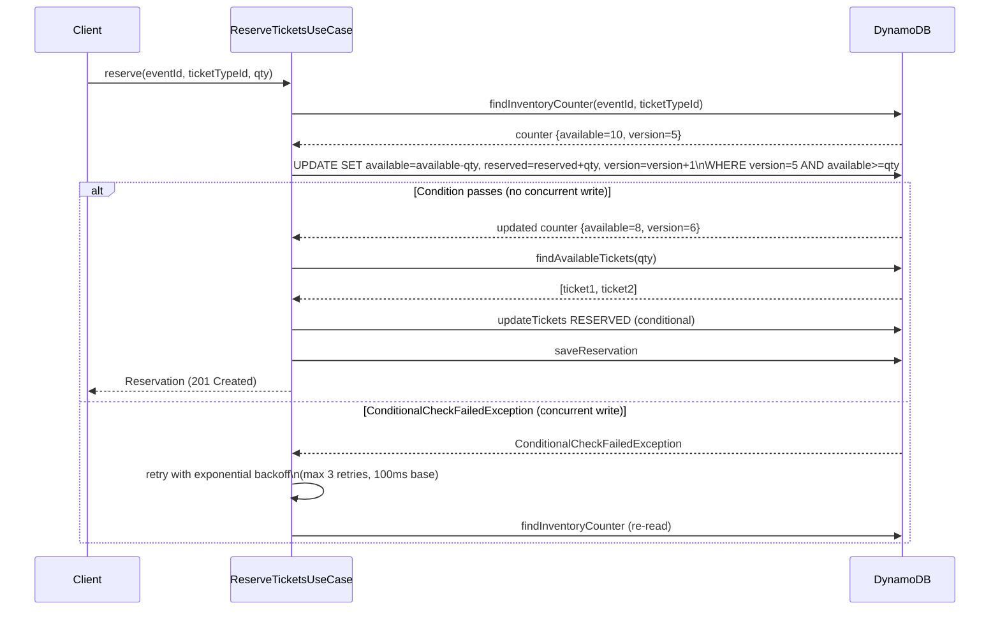
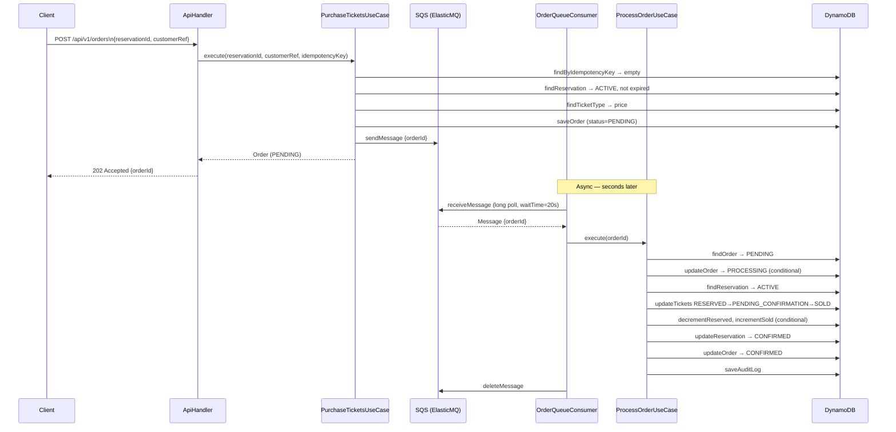
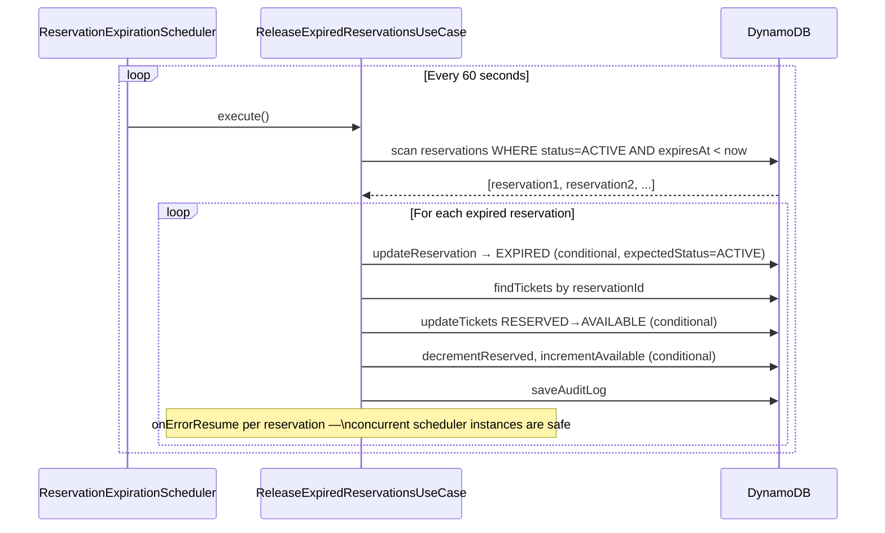
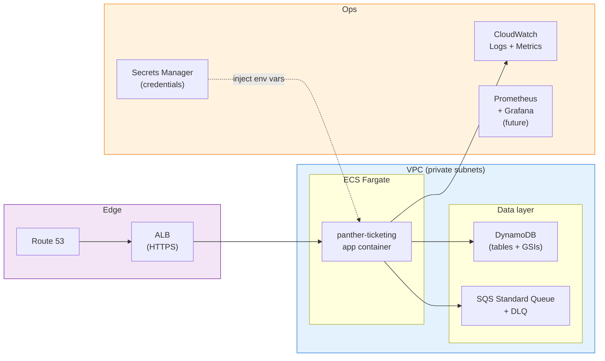

# Architecture Diagrams


---

## 1. Hexagonal Architecture — Module Structure



---

## 2. Ticket State Machine



---

## 3. Order State Machine



---

## 4. Rate Limiting — Request Flow



> `RateLimitFilter` writes the 429 JSON response directly — it does not throw an exception,
> so `GlobalErrorHandler` is not involved. Limits are configured in `application.yml`
> under `rate-limit.reservations.*` and `rate-limit.orders.*`.

---

## 4. Inventory Counter — Optimistic Locking Flow



---

## 5. Ticket State Machine — `PENDING_CONFIRMATION` detail

`PENDING_CONFIRMATION` is a **transient internal state** that exists only during `ProcessOrderUseCase` execution. It is never the final observable state of a ticket under normal operation.

```
POST /api/v1/orders
  → order: PENDING  (enqueued to SQS, 202 returned immediately)

SQS consumer → ProcessOrderUseCase:
  order:  PENDING → PROCESSING
  ticket: RESERVED → PENDING_CONFIRMATION   (conditional write #1)
  ticket: PENDING_CONFIRMATION → SOLD       (conditional write #2)
  counter: reservedCount--, soldCount++
  reservation: ACTIVE → CONFIRMED
  order:  PROCESSING → CONFIRMED

GET /api/v1/orders/{orderId}
  → order: CONFIRMED  (tickets already SOLD)
```

Why two writes instead of one? If the process crashes between write #1 and write #2, the ticket is stuck in `PENDING_CONFIRMATION`. The expiry scheduler only releases `RESERVED` tickets, so it will not accidentally return a partially-processed ticket to `AVAILABLE`. A manual reconciliation or a future `TransactWriteItems` migration would clean this up.

---

## 6. Async Purchase Flow (end-to-end)



---

## 6. Reservation Expiry Flow (Scheduler)



---

## 7. Production AWS Deployment (reference)


