# Especificación Técnica: Panther Ticketing

## 1. Control de Cambios

| Fecha | Versión | Cambio | Autor |
|-------|---------|--------|-------|
| 2026-10-10 | v1.0 | Creación del documento | Sebastian Giraldo |

---

## 2. Información General

### 2.1. Resumen

> Backend reactivo para la compra de boletas de eventos. Expone una API REST sobre Spring WebFlux que cubre el ciclo completo: creación de eventos, reserva de tiquetes con hold de 10 minutos, compra asíncrona vía SQS, consulta de estado de orden y marcación de tiquetes como cortesía. La consistencia anti-overselling se garantiza mediante escrituras condicionales en DynamoDB (optimistic locking) sin bloqueos pesimistas.

### 2.2. Referencias

| Nombre | Descripción |
|--------|-------------|
| README | [README.md](../README.md) |
| Guía de puesta en marcha | [PUESTA_EN_MARCHA.md](PUESTA_EN_MARCHA.md) |
| Infraestructura local | [INFRAESTRUCTURA.md](INFRAESTRUCTURA.md) |
| Colección Postman | [panther-ticketing.postman_collection.json](postman/panther-ticketing.postman_collection.json) |

---

## 3. Especificaciones Técnicas

### 3.1. Stack Tecnológico

| Capa | Tecnología |
|------|------------|
| Lenguaje | Java 25 (records, pattern matching, sealed classes) |
| Framework | Spring Boot 4.1.0-RC1 + Spring WebFlux |
| Persistencia | DynamoDB Local (`amazon/dynamodb-local`) — AWS SDK v2 async |
| Mensajería | SQS Standard vía ElasticMQ (at-least-once delivery) |
| Build | Gradle 9.x multi-módulo |
| Contenedores | Podman (`podman compose`) |

### 3.2. Arquitectura de Módulos

```
panther-ticketing/
├── applications/app-service/       # Entry point Spring Boot, wiring, scheduler
├── domain/
│   ├── model/                      # Records/entidades de dominio — sin dependencias de framework
│   ├── ports/                      # Interfaces: ports.in (casos de uso) + ports.out (gateways)
│   └── use-case/                   # Lógica de negocio — depende solo de model + ports
└── infrastructure/
    ├── entry-points/reactive-web/  # RouterFunction + ApiHandler + DTOs + GlobalErrorHandler
    ├── driven-adapters/dynamodb/   # Adaptadores DynamoDbAsyncClient (escrituras condicionales)
    ├── driven-adapters/sqs/        # Productor SQS + consumidor long-polling
    └── helpers/                    # RequestParameterValidator, utilidades compartidas
```

### 3.3. Reglas de Dependencia (ArchUnit)

| Módulo | Puede depender de |
|--------|-------------------|
| `domain/model` | — (ninguna) |
| `domain/ports` | `model` |
| `domain/use-case` | `model`, `ports` |
| `infrastructure/*` | `domain` (nunca al revés) |

### 3.4. Seguridad

| Aspecto | Implementación |
|---------|----------------|
| Protocolo | REST/HTTP (HTTPS en producción) |
| Autenticación | No implementada en este scope (local dev) |
| Credenciales AWS | Variables de entorno / `.env` (dummies en local) |
| Auditoría | Tabla DynamoDB `panther-audit` |

---

## 4. Flujos de la API

### 4.1. POST /api/v1/events — Crear Evento

#### 4.1.1. Información General

- **Propósito**: Crea un evento con sus tipos de tiquete y pre-materializa todos los registros `Ticket` en estado `AVAILABLE`. Inicializa el `InventoryCounter` por cada `TicketType`.
- **Decisión clave**: Generación eager de tiquetes — todos los `totalQuantity` registros se crean al momento de la creación del evento para que el state machine sea observable desde el inicio.

#### 4.1.2. Diagrama de Secuencia

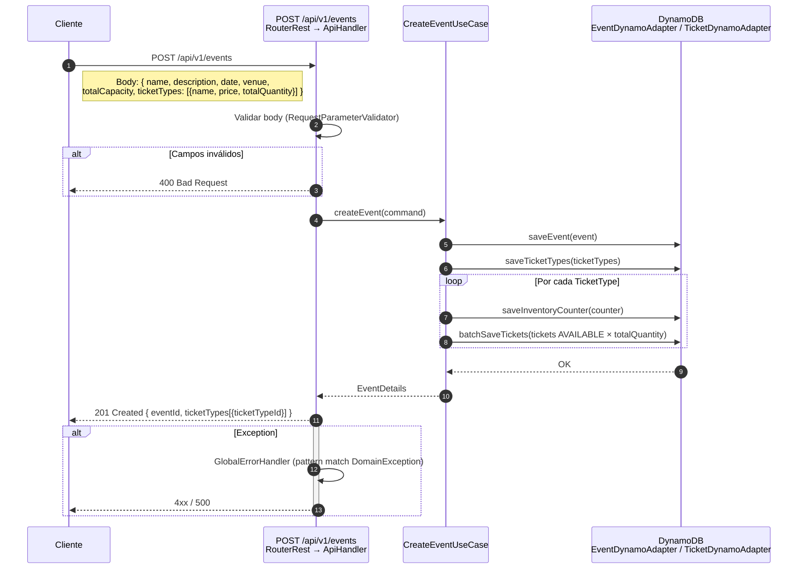

#### 4.1.3. Modelos involucrados

| Entidad | Tabla DynamoDB | Notas |
|---------|---------------|-------|
| `Event` | `panther-events` | PK: `eventId` |
| `TicketType` | `panther-ticket-types` | PK: `ticketTypeId`, SK: `eventId` |
| `InventoryCounter` | `panther-inventory` | PK: `ticketTypeId`; atributos: `availableCount`, `reservedCount`, `soldCount`, `version` |
| `Ticket` | `panther-tickets` | PK: `ticketId`, GSI: `ticketTypeId`; estado inicial: `AVAILABLE` |

---

### 4.2. POST /api/v1/events/{eventId}/reservations — Reservar Tiquetes

#### 4.2.1. Información General

- **Propósito**: Reserva `quantity` tiquetes para un `ticketTypeId` dado. Aplica hold de 10 minutos. Garantiza anti-overselling mediante escritura condicional sobre `InventoryCounter` (optimistic locking con `version`).
- **Decisión clave**: El `InventoryCounter` es la única barrera contra overselling. Los tiquetes individuales se transicionan `AVAILABLE → RESERVED` en escrituras separadas (trade-off documentado — ver ADR-1).

#### 4.2.2. Diagrama de Secuencia

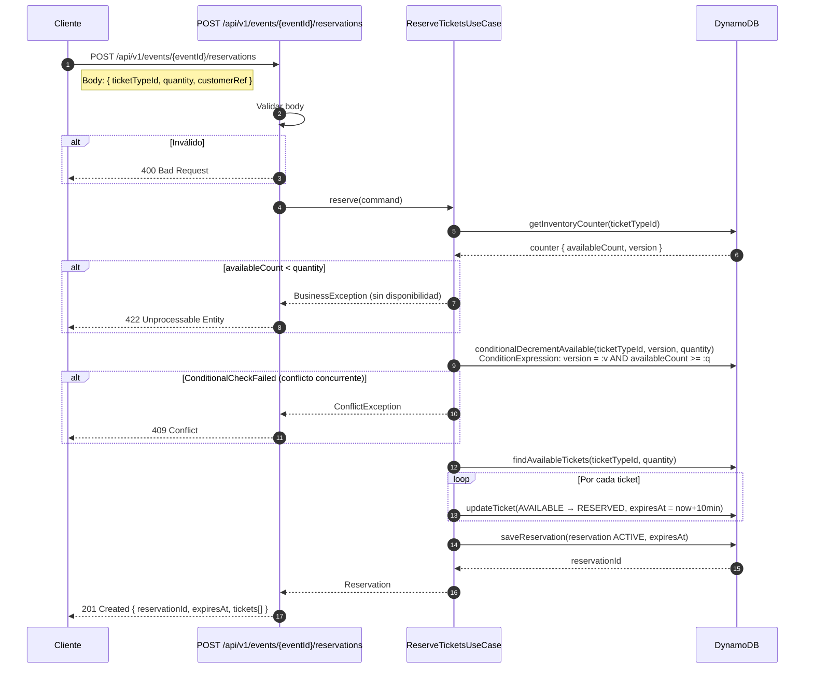

#### 4.2.3. Estados post-reserva

| Contador | Antes | Después (quantity=2) |
|----------|-------|----------------------|
| `availableCount` | N | N-2 |
| `reservedCount` | M | M+2 |
| `soldCount` | S | S |

---

### 4.3. POST /api/v1/orders — Comprar (async)

#### 4.3.1. Información General

- **Propósito**: Encola la orden en SQS y retorna `orderId` inmediatamente (202 Accepted). El procesamiento real ocurre en el consumidor long-polling.
- **Idempotencia**: `idempotencyKey` previene órdenes duplicadas. El consumidor verifica el estado de la orden antes de mutar.

#### 4.3.2. Diagrama de Secuencia

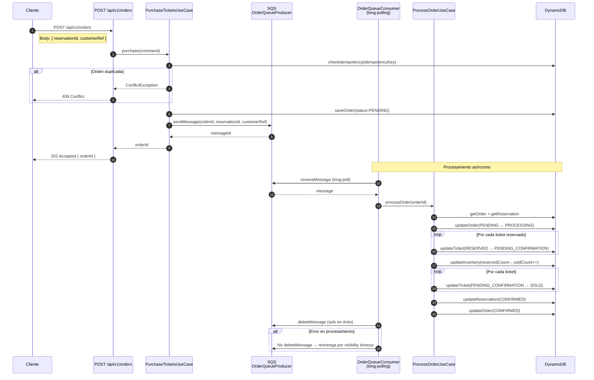

---

### 4.4. GET /api/v1/orders/{orderId} — Estado de Orden

#### 4.4.1. Información General

- **Propósito**: Consulta el estado actual de una orden. Permite al cliente hacer polling tras el 202 de compra.

#### 4.4.2. Diagrama de Secuencia

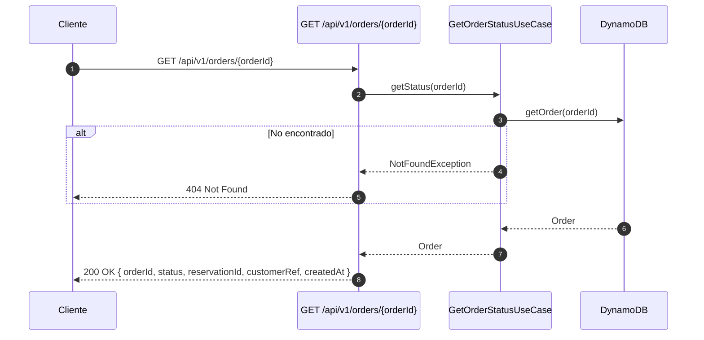

---

### 4.5. GET /api/v1/events/{eventId}/availability — Disponibilidad

#### 4.5.1. Información General

- **Propósito**: Lectura O(1) de disponibilidad en tiempo real desde `InventoryCounter`. No escanea tiquetes individuales.

#### 4.5.2. Diagrama de Secuencia

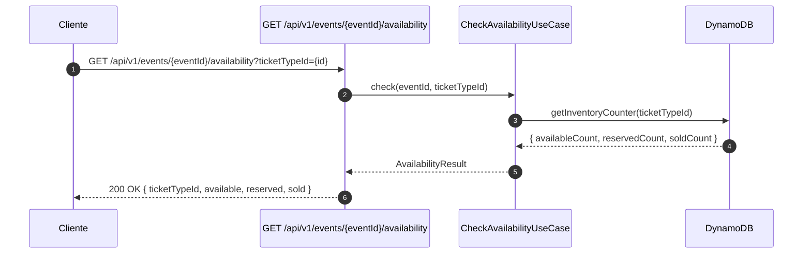

---

### 4.6. POST /api/v1/events/{eventId}/complimentary — Cortesía

#### 4.6.1. Información General

- **Propósito**: Finaliza una reserva activa marcando todos sus tiquetes como `COMPLIMENTARY`. No es una venta — `soldCount` no se modifica, solo `reservedCount` se decrementa. Registra auditoría.
- **Precondición**: La reserva debe estar en estado `ACTIVE`.

#### 4.6.2. Diagrama de Secuencia

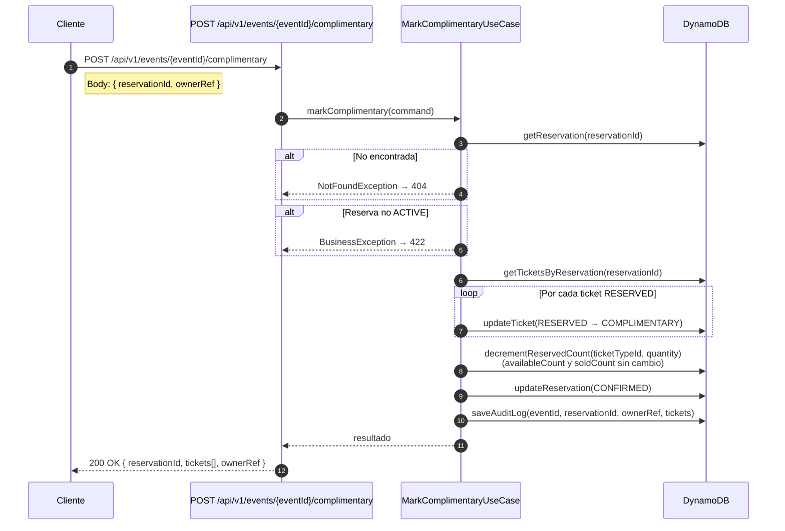

#### 4.6.3. Efecto en contadores

| Contador | Antes | Después (quantity=2) |
|----------|-------|----------------------|
| `availableCount` | N | N (sin cambio) |
| `reservedCount` | M | M-2 |
| `soldCount` | S | S (sin cambio) |

---

## 5. Máquinas de Estado

### 5.1. Estado de Tiquete

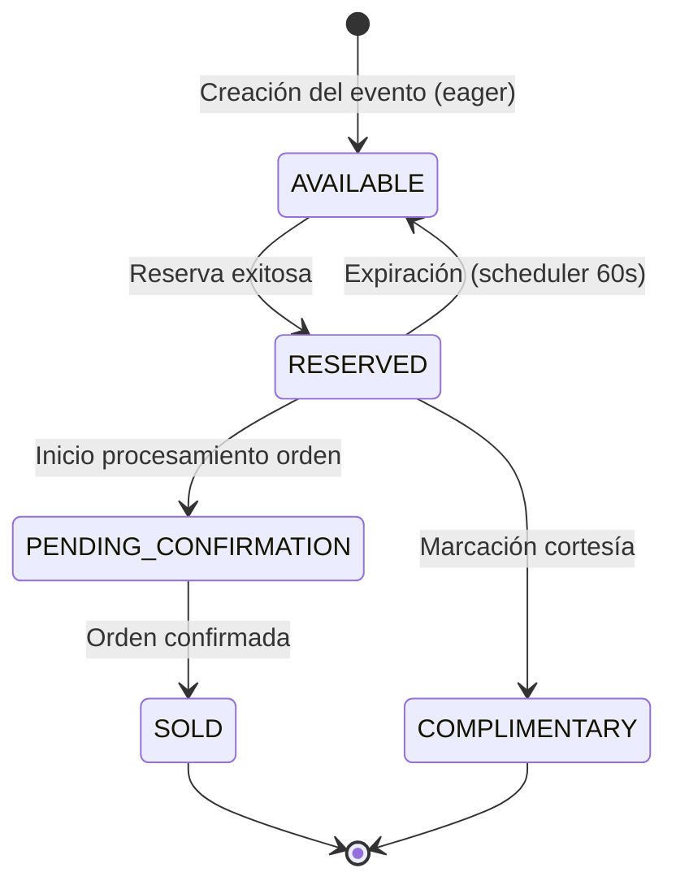

### 5.2. Estado de Orden

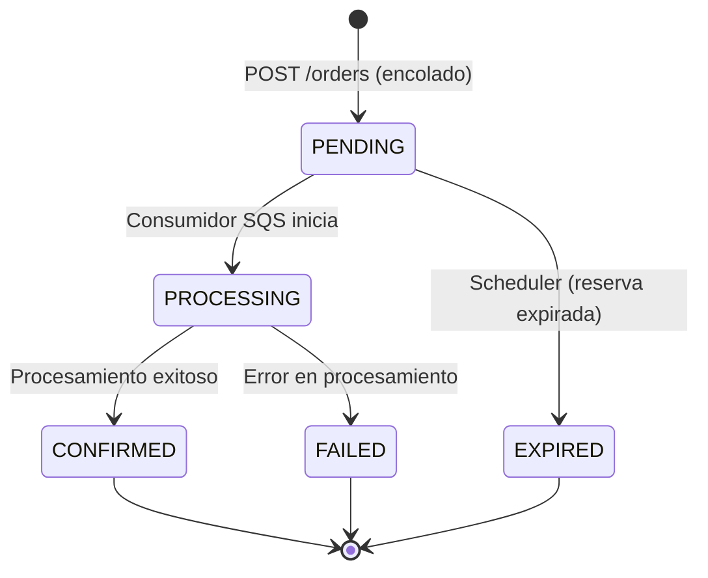

### 5.3. Estado de Reserva

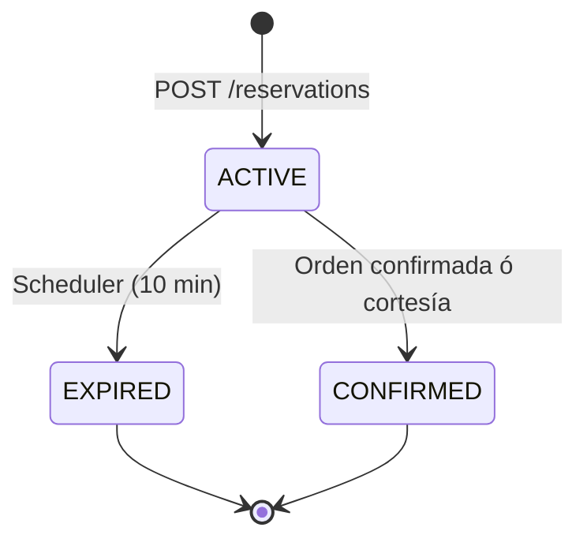

---

## 6. Modelo de Datos (DynamoDB)

| Tabla | PK | SK / GSI | Atributos clave |
|-------|----|----------|-----------------|
| `panther-events` | `eventId` | — | `name`, `date`, `venue`, `totalCapacity` |
| `panther-ticket-types` | `ticketTypeId` | GSI: `eventId` | `name`, `price`, `totalQuantity` |
| `panther-tickets` | `ticketId` | GSI: `ticketTypeId`, `reservationId` | `status`, `expiresAt`, `version` |
| `panther-reservations` | `reservationId` | GSI: `eventId` | `status`, `expiresAt`, `customerRef`, `ticketIds[]` |
| `panther-orders` | `orderId` | GSI: `reservationId` | `status`, `customerRef`, `idempotencyKey` |
| `panther-inventory` | `ticketTypeId` | — | `availableCount`, `reservedCount`, `soldCount`, `version` |
| `panther-audit` | `auditId` | GSI: `reservationId` | `eventId`, `ownerRef`, `action`, `timestamp` |

---

## 7. Infraestructura Local

### 7.1. Servicios

| Servicio | Imagen | Puerto | Propósito |
|----------|--------|--------|-----------|
| `dynamodb-local` | `amazon/dynamodb-local` | 8000 | Persistencia |
| `sqs` | `softwaremill/elasticmq` | 9324 | Cola de órdenes |
| `dynamodb-admin` | `aaronshaf/dynamodb-admin` | 8001 | UI web DynamoDB |
| `init-resources` | `amazon/aws-cli` | — | Crea tablas y colas (one-shot) |
| `app` | `eclipse-temurin:25` | 8080 | Aplicación |

### 7.2. Diagrama de Infraestructura

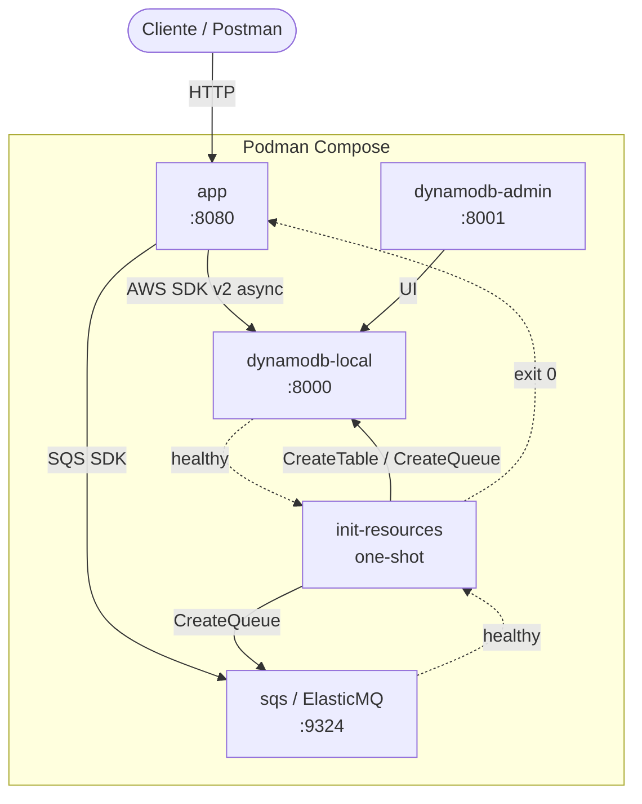

### 7.3. Configuración (`application.yml`)

| Propiedad | Default local | Override (env var) |
|-----------|--------------|-------------------|
| `aws.region` | `us-east-1` | `AWS_REGION` |
| `aws.dynamodb.endpoint` | `http://localhost:8000` | `DYNAMODB_ENDPOINT` |
| `aws.sqs.endpoint` | `http://localhost:9324` | `SQS_ENDPOINT` |
| `aws.sqs.queue-url` | `http://localhost:9324/000000000000/panther-orders` | `SQS_QUEUE_URL` |
| `reservation.minutes` | `10` | — |
| `reservation.scheduler.delay-ms` | `60000` | `RESERVATION_SCHEDULER_DELAY_MS` |
| `server.port` | `8080` | `SERVER_PORT` |

---

## 8. Decisiones de Arquitectura (ADRs)

| # | Decisión | Justificación |
|---|----------|---------------|
| ADR-1 | Contador + tiquetes individuales con escrituras separadas (no `TransactWriteItems`) | Simplicidad en primera iteración. El contador es la barrera de overselling; la inconsistencia transitoria es aceptada. Hardening: usar `TransactWriteItems` (≤100 ítems, compatible con el cap de 10 tiquetes/compra). |
| ADR-2 | Generación eager de tiquetes al crear evento | Hace observable el state machine completo desde el inicio. Para capacidades muy grandes, usar generación lazy o en chunks. |
| ADR-3 | Flujo de compra asíncrono (SQS + 202) | Desacopla la latencia de procesamiento del cliente. Permite reintentos automáticos por visibility timeout. |
| ADR-4 | `InventoryCounter` separado de los tiquetes | Lectura O(1) de disponibilidad sin escanear la tabla de tiquetes (req 4.7). |
| ADR-5 | Cortesía como acción terminal sobre reserva existente | Elimina la necesidad de conocer `ticketId` individuales. Reutiliza el flujo de reserva. |
| ADR-6 | No hay cuenta AWS real necesaria | DynamoDB Local + ElasticMQ corren offline. Credenciales dummy — los emuladores no las validan. |

---

## 9. Manejo de Errores

### 9.1. Jerarquía de excepciones de dominio

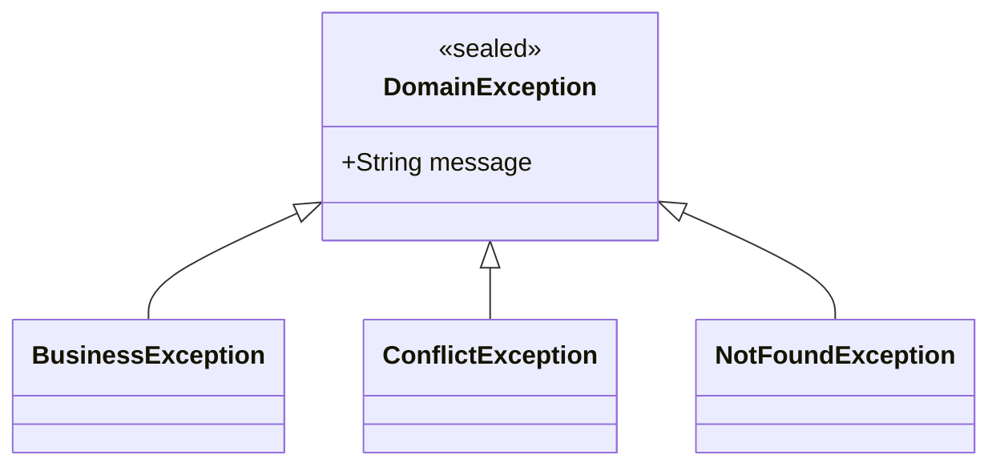

### 9.2. Mapeo HTTP (`GlobalErrorHandler`)

| Excepción | HTTP | Escenario |
|-----------|------|-----------|
| `BusinessException` | 422 | Regla de negocio violada (sin disponibilidad, reserva no activa, etc.) |
| `ConflictException` | 409 | Conflicto de escritura condicional (concurrent update) |
| `NotFoundException` | 404 | Recurso no encontrado |
| Otros `Throwable` | 500 | Error no controlado |

---

## 10. Repositorio y Despliegue

### 10.1. Ejecución local

```bash
# Todo en contenedores (recomendado)
podman compose up --build

# Infra en contenedores + app en host
podman compose up dynamodb-local sqs dynamodb-admin init-resources
./gradlew :app-service:bootRun
```

### 10.2. Endpoints disponibles

| Método | Path | Descripción |
|--------|------|-------------|
| POST | `/api/v1/events` | Crear evento con tipos de tiquete |
| GET | `/api/v1/events/{eventId}` | Obtener evento |
| GET | `/api/v1/events/{eventId}/availability?ticketTypeId=` | Disponibilidad en tiempo real |
| POST | `/api/v1/events/{eventId}/reservations` | Reservar tiquetes (hold 10 min) |
| POST | `/api/v1/orders` | Comprar (async — retorna 202) |
| GET | `/api/v1/orders/{orderId}` | Estado de orden |
| POST | `/api/v1/events/{eventId}/complimentary` | Marcar reserva como cortesía |
| GET | `/actuator/health` | Health check (liveness + readiness) |

### 10.3. Extensiones futuras (fuera de scope)

| Extensión | Descripción |
|-----------|-------------|
| Gate scanning / `USED` | `SOLD → USED` vía escritura condicional idempotente + QR firmado (JWT) |
| Terraform IaC | Tablas DynamoDB, cola SQS, ECS/Fargate, IAM least-privilege |
| Observabilidad | Micrometer + Prometheus + Grafana (queue depth, expiry rate, conflict rate) |
| Virtual threads | Alternativa a WebFlux para workloads blocking-I/O (Java 25 estable) |
| `TransactWriteItems` | Atomicidad contador + tiquetes en una sola transacción DynamoDB |
